# Визуальный разбор референсов: цвет, шрифт, сетка

Дата: 27.10.2026. Все 7 сайтов сняты на телефоне (390×844, ретина) и на ПК (1440×900), с прокруткой до конца. Цвета получены двумя способами: из кода страницы (что задал дизайнер) и из самих снимков (сколько места на экране занимает каждый цвет). Контраст посчитан по WCAG: для обычного текста нужно не меньше 4.5:1.

Движение (переходы, анимации) здесь не разбираем: это отдельный документ.

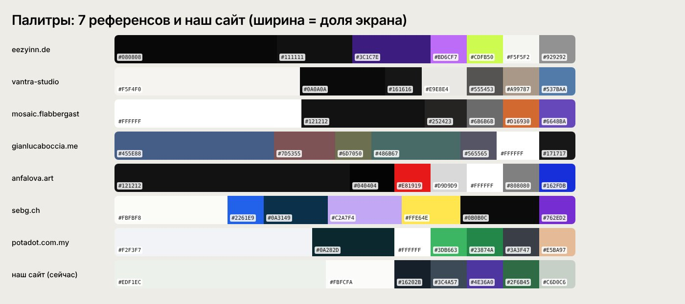

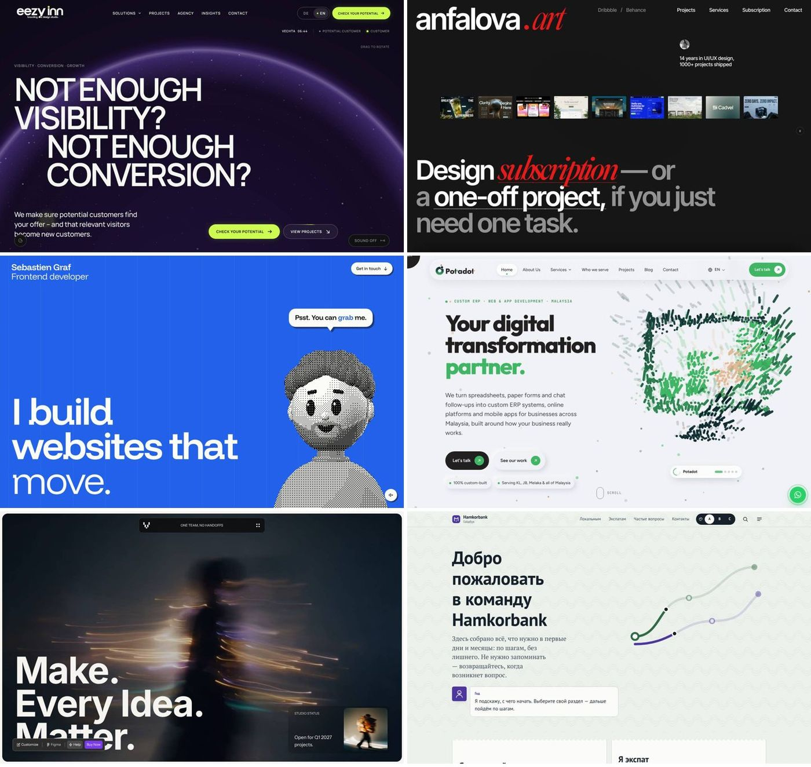

---

## 1. eezyinn.de

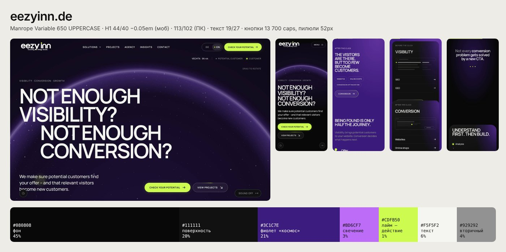

**Коротко:** ночной космос. Чёрный фон, целые блоки глубокого фиолетового, и одна «кислотная» лаймовая кнопка, на которую невозможно не нажать.

| Роль | Цвет | Доля экрана |
|---|---|---|
| Фон | `#080808` / поверхность `#111111` | ~65% |
| Фиолетовые блоки «космос» | `#3C1C7E` + свечение `#BD6CF7` | ~21% |
| Действие (кнопки, точки, фокус) | `#CDFB50` лайм | ~1% |
| Текст / вторичный | `#F5F5F2` / `#929292` | |

- Цвет работает **полями**: секции чередуются чёрный → фиолетовый → чёрный. Фиолетовый подан радиальным градиентом со свечением в углу: `radial-gradient(95% 75% at 88% 0%, rgb(189 108 247 / .45), transparent 62%), #3C1C7E`.
- Лайм занимает 1% экрана, но держит весь сайт: только кнопки, точки на схемах и `box-shadow: 0 0 22px rgba(205,251,80,.2)` (свечение).
- **Шрифт:** Manrope Variable (есть кириллица). Заголовки 650, ЗАГЛАВНЫЕ, трекинг −0.05em, межстрочный 0.92. Телефон: H1 44/40, H3 30/29; ПК: H1 113/102. Текст 19/27 (500). Подписи 13px 600.
- **Сетка/детали:** кнопки-пилюли 52px высотой, `border-radius: 999px`, текст 13px 700 caps; вторичная кнопка — прозрачная с рамкой `1px rgba(245,245,242,.34)`. Карточки 18px радиус, вместо теней — внутренняя рамка `inset 0 0 0 1px rgba(245,245,242,.08)`.
- **Контраст:** текст 18.3:1, серый 6.4:1, лайм с чёрным текстом 16.7:1.

**3 сильные идеи:** (1) один сигнальный цвет на 1% экрана; (2) цвет как пространство (целые фиолетовые секции со свечением); (3) огромные заглавные заголовки, сжатые по трекингу.

## 2. vantra-studio.webflow.io (владельцу понравился больше всего за читаемость)

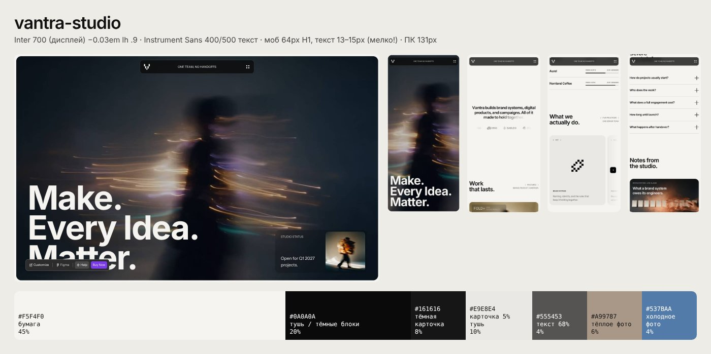

**Коротко:** тёплая бумага и чёрная тушь. Цвета почти нет: его дают фотографии (размытые в движении). Поэтому интерфейс спокойный, а страница всё равно живая.

| Роль | Цвет | Доля |
|---|---|---|
| Фон «бумага» | `#F5F4F0` | ~45% |
| Тушь: текст и тёмные блоки (первый экран, подвал) | `#0A0A0A`, тёмная карточка `#161616` | ~30% |
| Карточка на бумаге | тушь 5% = `#E9E8E4` | ~10% |
| Текст абзацев | тушь 68% = `#555453` | |
| Цвет фото | тёплый `#A99787`, ржавый `#8C4329`, синий `#537BAA` | ~15% |

- **Ритм:** тёмный первый экран → светлое содержание → тёмный подвал. Ровно три зоны, без пестроты.
- **Шрифт:** Inter 700 для крупных заголовков (−0.03em, межстрочный 0.9), Instrument Sans 400/500 для текста. **Instrument Sans без кириллицы**, Inter с кириллицей. Телефон: H1 64/58, H2 ~36, текст 13–15px (мелко; читается за счёт большого воздуха и контраста). ПК: H1 131px, текст 18.75/28.
- **Порядок и кнопки (то, что понравилось):** у каждой секции слева крупный заголовок из 2–3 слов («What we actually do.»), справа маленькая подпись в скобках «( FIVE PRACTICES )». Услуги — горизонтальная лента больших карточек `( 001 )`, `( 002 )` с пиксельной иконкой и чёрной квадратной кнопкой-стрелкой 64px. Вопросы — список с тонкими линиями и «+» справа. Статьи — строки: категория мелко caps, заголовок, дата, иконка ↗.
- **Навигация:** плавающая тёмная плашка сверху, отступ 16px от краёв, `background: rgba(10,10,10,.78); backdrop-filter: blur(10px) saturate(1.3); border-radius: 12px`, высота 45px (телефон).
- **Радиусы:** 20px карточки, 8px кнопки, 999px метки. Теней нет, только тонкие линии `1px rgba(10,10,10,.16)`.
- **Контраст:** тушь 18:1, текст 68% — 6.8:1, подписи 48% — **3.4:1 (не проходит)**.

**3 сильные идеи:** (1) почти монохромный интерфейс + цвет только в изображениях; (2) нумерация `( 001 )` и подписи в скобках: порядок виден сразу; (3) плавающая стеклянная плашка меню.

## 3. mosaic.flabbergast.agency

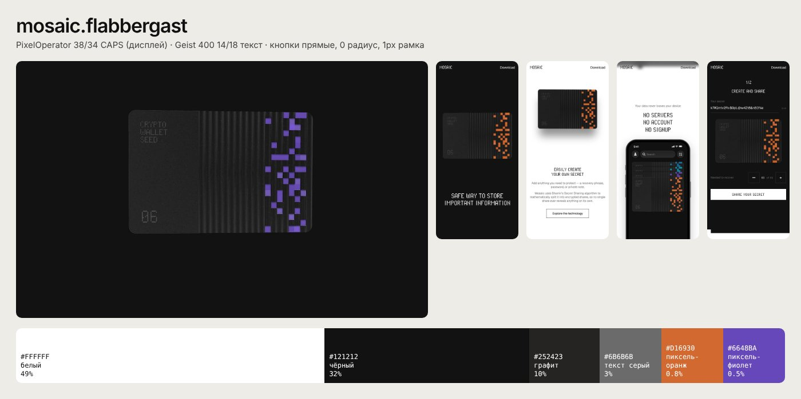

**Коротко:** строгий чёрно-белый, как техническая документация, и один пиксельный цветной узор на «карточке-секрете».

| Роль | Цвет | Доля |
|---|---|---|
| Белый / чёрный блоки | `#FFFFFF` / `#121212` | ~49% / ~32% |
| Графит | `#252423` | ~10% |
| Текст абзацев | `#6B6B6B` | |
| Пиксельный акцент | `#D16930` оранжевый (на телефоне), `#6648BA` фиолет (на ПК, цвет меняется) | <1% |

- Секции чередуются чёрная/белая. Сверху вниз идут 4 вертикальные линейки сетки на 50% прозрачности (`--rule-1..4`): сетку видно.
- **Шрифт:** PixelOperator (пиксельный, только латиница) для заголовков 38/34 CAPS; Geist 400 14/18 для текста (у Geist **есть** кириллица). Кнопки прямоугольные, радиус 0, рамка 1px.
- **Контраст:** серый `#6B6B6B` на белом 5.3:1, тот же серый на чёрном **3.5:1 (не проходит)**.

**3 сильные идеи:** (1) один «предмет-герой» (карточка с пиксельным узором), который ездит по всей странице; (2) видимая сетка-линейка; (3) пиксельная фактура как подпись бренда.

## 4. gianlucaboccia.me

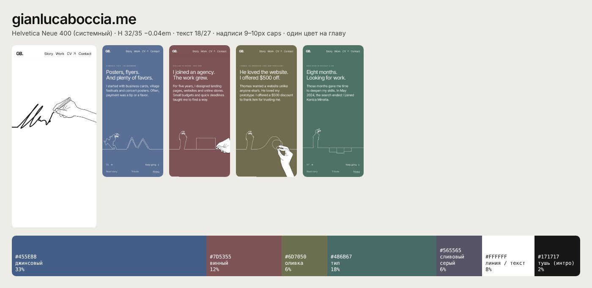
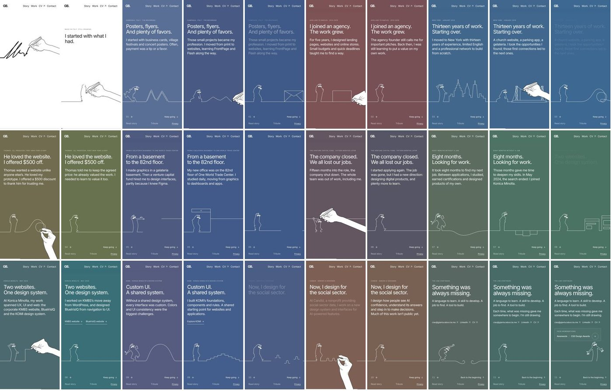

**Коротко:** история жизни по главам. Каждая глава — свой приглушённый цвет фона, по низу экрана тянется одна белая линия, которую «рисует рука».

| Роль | Цвет |
|---|---|
| Главы | джинсовый `#455E88`, винный `#7D5355`, оливка `#6D7050`, тил `#486B67`, сливово-серый `#565565` |
| Линия и текст | `#FFFFFF` |
| Вступление | белый `#FFFFFF` + тушь `#171717` |

- Цвет фона плавно перетекает при прокрутке (снимки показывают промежуточные оттенки). Цвета **приглушённые** (насыщенность 20–35%), поэтому белый текст на всех проходит 5.1–6.5:1.
- **Шрифт:** системный Helvetica Neue 400 (веб-шрифта нет совсем). Заголовок 32/35, −0.04em; текст 18/27; подписи 9–10px caps (слишком мелко).
- Есть кнопка «Read the story without animation»: хорошая забота о доступности.

**3 сильные идеи:** (1) один цвет на главу, и он меняется вместе с историей; (2) одна линия через весь сайт; (3) минимум элементов: только текст и линия.

## 5. anfalova.art

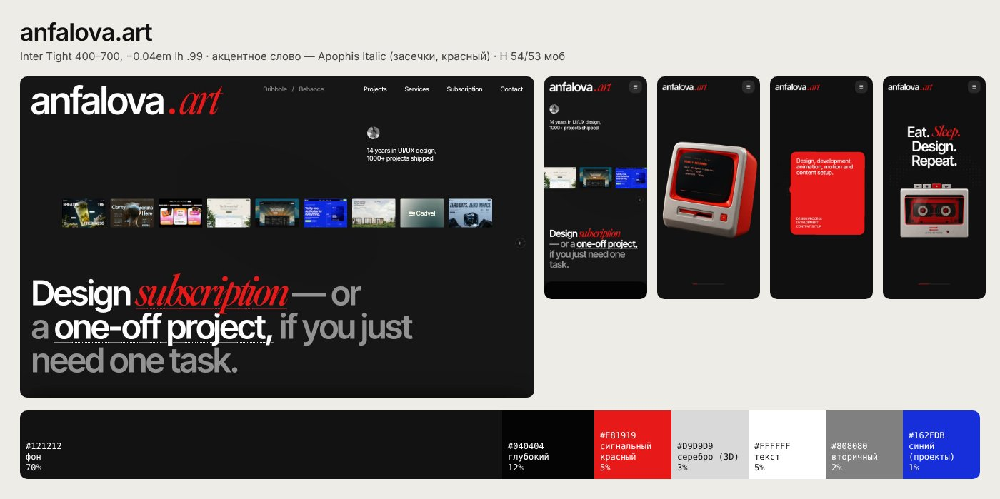

**Коротко:** чёрный графит + один сигнальный красный. Ретро-предметы в 3D (монитор, кассета), пиксельная сетка из красных и серых квадратов, одно слово в заголовке набрано рукописным курсивом с засечками.

| Роль | Цвет | Доля |
|---|---|---|
| Фон | `#121212` / `#040404` | ~82% |
| Сигнальный красный | `#E81919` | ~5% |
| Серебро (3D-предметы) | `#D9D9D9` | ~3% |
| Текст / вторичный | `#FFFFFF` / `#808080` | |

- **Шрифт:** Inter Tight 400–700 (кириллица есть), трекинг −0.04em, межстрочный 0.99; телефон: H 54/53, H2 36, текст 16–20. Акцентное слово — Apophis Italic (коммерческий, кириллицы нет), красным.
- Карточки 20–24px радиус, кнопка — красная пилюля + отдельный круг со стрелкой ↗ рядом («Get a quote ⟶ ↗»).
- **Контраст:** белый 18.7:1; серый 4.7:1; белый на красном 4.6:1 (на грани); красный текст на чёрном 4.1:1 (только для крупного).

**3 сильные идеи:** (1) одно слово-курсив в гротескном заголовке; (2) кнопка «пилюля + круг со стрелкой»; (3) предметы-герои вместо иллюстраций.

## 6. sebg.ch

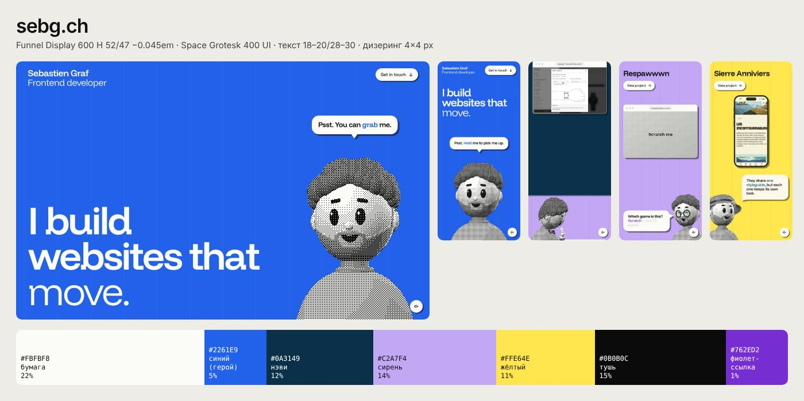

**Коротко:** яркие плоские цветовые поля (синий, нэви, сирень, жёлтый) и персонаж, нарисованный точками (дизеринг), который комментирует страницу.

| Роль | Цвет | Доля |
|---|---|---|
| Бумага | `#FBFBF8`, `#F1F1EC` | ~30% |
| Поля проектов | синий `#2261E9`, нэви `#0A3149`, сирень `#C2A7F4`, жёлтый `#FFE64E` | ~40% |
| Тушь | `#0B0B0C` | ~15% |
| Ссылка-акцент | `#762ED2` | |

- Каждый проект занимает свой цвет, одно поле на экран. Персонаж и мокапы сделаны **дизерингом**: в коде это `--dither: conic-gradient(ink 25%, transparent 0 50%, ink 0 75%, transparent 0) 0 0 / 4px 4px`.
- Вертикальные полосы-направляющие `repeating-linear-gradient(to right, rgb(11 11 12 / .09) 0 1px, transparent 1px …)`.
- **Шрифт:** Funnel Display 600 (заголовки 52/47, −0.045em) + Space Grotesk (интерфейс). **Ни у одного нет кириллицы.** Текст 18–20/28–30.
- Сетка 4 колонки, `--margin: clamp(1.25rem, 2.8vw, 3rem)` → 20px на телефоне.
- **Контраст:** тушь на сирени 9.5:1, на жёлтом 15.6:1, белый на синем 5.3:1; фиолетовая ссылка на сирени **3.3:1 (не проходит)**.

**3 сильные идеи:** (1) персонаж-гид из точек; (2) одно плоское цветовое поле на экран; (3) дизеринг как общая фактура для персонажа и картинок.

## 7. potadot.com.my

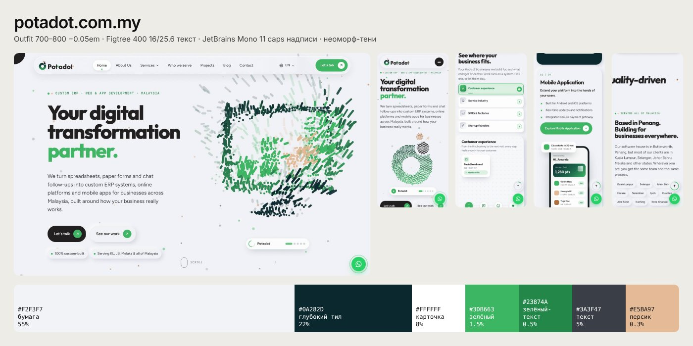

**Коротко:** светлый серо-голубой «пластик», глубокий тил и зелёный. Много мокапов телефона и приложения, мягкие выпуклые тени.

| Роль | Цвет | Доля |
|---|---|---|
| Бумага | `#F2F3F7` | ~55% |
| Тёмные секции | `#0A282D` | ~22% |
| Зелёный / зелёный для текста | `#3DB663` / `#23874A` | ~2% |
| Текст / вторичный | `#3A3F47` / `#646B76` | |

- Неоморфизм: `box-shadow: 12px 12px 28px rgba(160,166,186,.42), -12px -12px 28px rgba(255,255,255,.95)`.
- **Шрифт:** Outfit 700–800 (−0.05em) + Figtree 400 16/25.6 + JetBrains Mono 11px caps для надписей «● ● WHO WE ARE». У Outfit и Figtree **нет кириллицы**, у JetBrains Mono есть.
- Сервисы — «01 / 04» на тёмных карточках 24px радиус с зелёной кнопкой-пилюлей и кругом со стрелкой; плавающая кнопка WhatsApp.
- **Контраст:** основной текст 9.6:1, серый 4.9:1, зелёный текст 4.1:1; белый на зелёной кнопке **2.6:1 (не проходит)**.

**3 сильные идеи:** (1) живые экраны приложения как иллюстрация; (2) моно-надписи с точками-маркерами; (3) тёмные карточки услуг с нумерацией «01 / 04».

---

## Что общего у всех семи (вкус владельца)

1. **Один сигнальный цвет на экран, остальное нейтральное.** Лайм 1%, красный 5%, оранжевый <1%, зелёный 2%. Нейтральный фон занимает 50–80% экрана, но он либо **очень тёмный** (`#080808`–`#121212`), либо **тёплая бумага** (`#F5F4F0`, `#FBFBF8`). Бледно-цветного фона нет ни у кого.
2. **Цвет как пространство.** Если цвета много, он подан целыми экранами (sebg, boccia, eezyinn): одна секция = одно поле. Тёмные и светлые секции чередуются.
3. **Крупный плотный гротеск.** Все заголовки: гротеск 600–700 с **отрицательным трекингом** −0.03…−0.05em и межстрочным 0.9–1.0. На телефоне H1 44–64px. Засечки — только как одно акцентное слово (anfalova).
4. **Одна фирменная техника.** Пиксели/дизеринг (mosaic, sebg, anfalova), одна линия от руки (boccia), свечение (eezyinn), размытое фото (vantra). Техника одна и повторяется везде.
5. **Интерфейс-«инструмент».** Моно-подписи caps с номерами `( 001 )`, `01 / 04`; кнопки-пилюли с кругом-стрелкой; плавающая стеклянная плашка меню; карточки с радиусом 18–24px; вместо теней тонкие линии; списки с «+» справа.

## Что не так с нашим сайтом сейчас

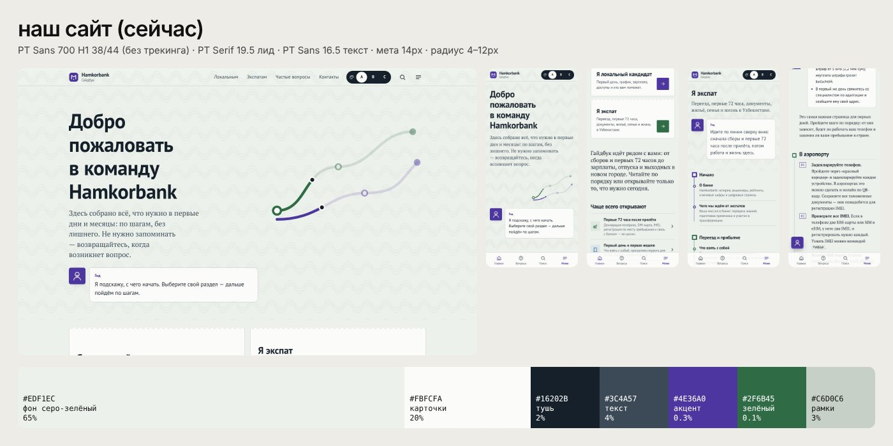

| Что видим | Цифры | Почему «шаблон / 2010» |
|---|---|---|
| Фон — бледный серо-зелёный на весь экран | `#EDF1EC` = **56–78%** экрана, на всех страницах один и тот же | У референсов фон — уверенный белый/бумага или почти чёрный. Бледный зелёный читается как «по умолчанию» |
| Акцента почти нет | фиолетовый `#4E36A0` = **0.1–0.4%** экрана | Нет точки, куда смотреть. У референсов сигнальный цвет ярче и контрастнее фона |
| Нет тёмных секций и цветовых полей | 1 зона на всю страницу | Нет ритма, нет «вау» при прокрутке |
| Шрифты PT Sans / PT Serif | H1 38/44, трекинг почти 0 (−0.01em); на странице «72 часа» текст скачет между PT Serif 19.5 и PT Sans 16.5/15.7/15.2/14.4 | PT — шрифт госбланков 2009 года. Пять размеров «текста» рядом выглядят как беспорядок, поэтому кажется «нечитаемым», хотя контраст в порядке (8.8:1) |
| Волнистый узор за текстом | фон-паттерн под заголовками | Фактура шумит за буквами |
| Карточки 4–12px радиус, рамка + тень, всё одного веса | `1px solid #C6D0C6` | Список одинаковых коробок: не видно, что главное |
| Нижняя панель с иконками «Главная / Вопросы / Поиск / Меню» + переключатель A/B/C | | Выглядит как шаблон мобильного приложения |
| Загружаются 13 начертаний 6 семейств (PT Serif, PT Sans, PT Mono, Golos, Onest, Neucha) | | Наследие трёх тем; после выбора стиля нужно оставить одно семейство + моно |

Плюс: контраст и размер текста у нас уже нормальные (16.5px, 5.5–8.8:1). Проблема не в контрасте, а в **отсутствии иерархии, характера и ритма**.

---

## Два предлагаемых направления

Оба: текст ≥17px (основной 18px), все пары «текст/фон» ≥4.5:1, шрифты с кириллицей и узбекской латиницей (`oʻ gʻ` = U+02BB) есть на Fontsource.

### Оценка «Абр / икат» (уже в работе)

**Что попадает во вкус владельца:**
- Цвета-поля (индиго, магента, шафран, изумруд) — то же, что у sebg и boccia: одна глава = один цвет.
- Икат с «размытым» краем нитей — это своя фирменная техника, родственная пикселям/дизерингу (mosaic, sebg) и размытию (vantra). И она своя, узбекская: не шаблон.
- JetBrains Mono для подписей — прямо как у potadot.

**Что не попадает:**
- **Четыре ярких цвета одновременно.** Ни один референс не держит больше одного яркого цвета на экране. Если икат будет фоном/обоями, получится «ярмарка», а не премиум.
- **Unbounded в заголовках.** Это широкий шрифт с квадратно-круглой кириллицей (`ж`, `д`, `л` заметно «мультяшные», см. картинку ниже). Все 7 референсов используют **узкий** гротеск с отрицательным трекингом. Кроме того, на телефоне длинные русские слова («Регистрация», «пребывания») при 34px едва помещаются в 358px.
- **Изумруд `#00926A`** с белым текстом даёт 3.95:1, это не проходит. Магента `#D3205F` как цвет текста на бумаге даёт 4.50:1, на самой границе.

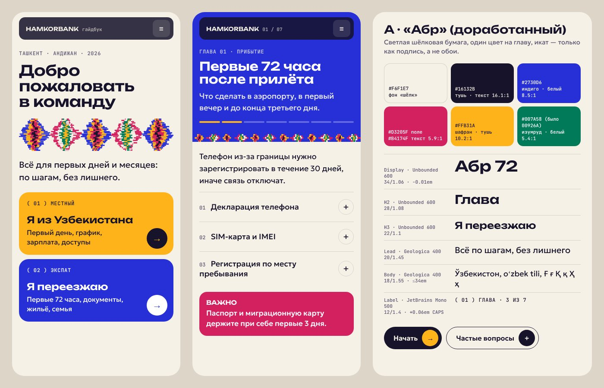

**Что поправить:**
1. Икат только как **подпись**: полоса-раппорт под заголовком главы, разделитель, индикатор прогресса. Фоном его не делать.
2. Правило «один яркий цвет на экран»: глава «Прибытие» индиго, «Документы» шафран, «Деньги» изумруд. Магента только для «Важно».
3. Заголовки набирать Inter Tight 600 (−0.035em), Unbounded оставить для крупных цифр («72», «01»): там он и правда хорош.
4. Цвета: изумруд `#00926A → #007A58` (белый 5.35:1), для текста магентой `#B4174F` (5.9:1).

### Направление A+ «Абр» (рекомендую)

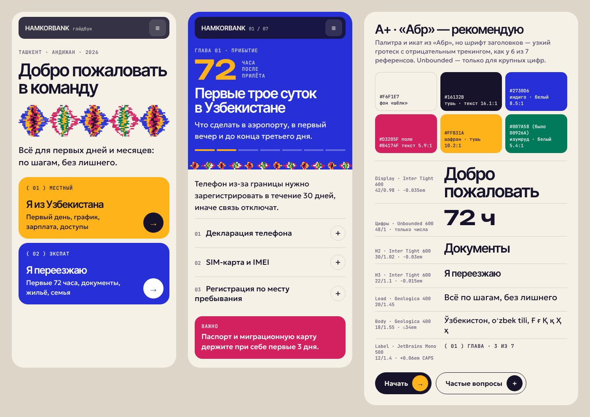

**Палитра**

| Токен | Hex | Роль | Контраст |
|---|---|---|---|
| `--paper` | `#F6F1E7` | фон «шёлк», ~60% экрана | — |
| `--ink` | `#16132B` | текст, плашка меню, тёмные кнопки | 16.1:1 на бумаге |
| `--indigo` | `#2730D6` | главный цвет: поле главы, ссылки | белый 8.5:1; на бумаге 7.5:1 |
| `--saffron` | `#FFB31A` | выделение, прогресс, поле с тёмным текстом | `--ink` 10.2:1 (белый нельзя: 1.8:1) |
| `--magenta` | `#D3205F` поле / `#B4174F` текст | только «Важно» | белый 5.1:1 / 5.9:1 |
| `--emerald` | `#007A58` | «готово», «сделано» | белый 5.35:1; на бумаге 4.75:1 |
| `--muted` | `#5A5570` | вторичный текст | 6.3:1 |

**Шрифты (npm):** `@fontsource-variable/inter-tight` (заголовки), `@fontsource-variable/geologica` (текст), `@fontsource-variable/jetbrains-mono` (подписи), `@fontsource/unbounded` 600 (только цифры). У всех есть `cyrillic` + `latin-ext`.

**Шкала для телефона**

| Уровень | Шрифт | Размер / межстрочный | Трекинг |
|---|---|---|---|
| Display (H1) | Inter Tight 600 | 42 / 0.98 | −0.035em |
| Цифра-герой | Unbounded 600 | 64 / 0.9 | 0 |
| H2 | Inter Tight 600 | 30–34 / 1.02 | −0.03em |
| H3 / карточка | Inter Tight 600 | 22–24 / 1.08 | −0.02em |
| Lead | Geologica 400 | 20 / 1.45 | 0 |
| Body | Geologica 400 | 18 / 1.55, не шире 34em | 0 |
| Label | JetBrains Mono 500 | 12 / 1.4, CAPS | +0.06em |

Поля 16px по бокам, радиусы: карточки 22px, кнопки 999px, плашка меню 14px. Теней нет, линии `1px rgba(22,19,43,.14)`.

**Схема (телефон)**
```
┌──────────────────────────────┐
│ ▓ HAMKORBANK гайдбук      [≡]│ ← плавающая плашка #16132B 86% + blur
│                              │
│ ТАШКЕНТ · АНДИЖАН · 2026     │ ← mono 12 caps
│ Добро пожаловать             │ ← Inter Tight 42/0.98
│ в команду                    │
│ ◆◇◆◇◆  (икат-раппорт)         │ ← сигнатура: нити «встают в регистр»
│ Всё для первых дней…         │ ← Geologica 20
│ ╭──────────────────────────╮ │
│ │( 01 ) МЕСТНЫЙ  шафран    │ │
│ │Я из Узбекистана      (→) │ │
│ ╰──────────────────────────╯ │
│ ╭──────────────────────────╮ │
│ │( 02 ) ЭКСПАТ   индиго    │ │
│ │Я переезжаю           (→) │ │
│ ╰──────────────────────────╯ │
├──────────────────────────────┤
│█ ГЛАВА 01 · ПРИБЫТИЕ ████████│ ← поле главы = 1 цвет
│█ 72 ЧАСА  (Unbounded)        │
│█ Первые трое суток…  ▬▬▭▭▭▭▭ │ ← прогресс шафраном
│◆◇◆◇◆◇◆◇◆◇◆◇ (кромка-икат)     │
│ текст 18/1.55 на бумаге      │
│ 01 Декларация телефона   (+) │ ← список с линиями (как vantra)
│ ▓ ВАЖНО (магента)            │
└──────────────────────────────┘
```

**Фирменный элемент:** *кромка-икат*. Полоса раппорта под каждой главой: при появлении на экране нити сдвинуты (как настоящий абр), потом встают в регистр. Цвет полосы совпадает с цветом главы. Икат используется только здесь, на обложке и в прогрессе.

### Направление B «Кошин»: ночь и изразец

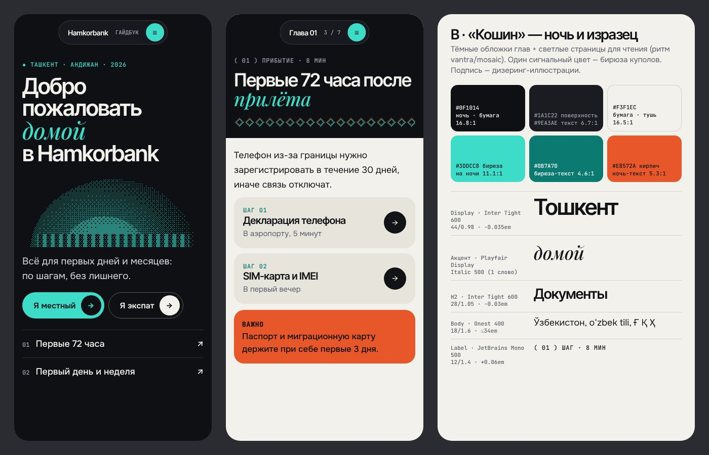

Ближе всего к eezyinn, anfalova и mosaic: тёмные обложки глав, светлые страницы для чтения (ритм vantra), один сигнальный цвет — бирюза куполов Самарканда и керамики ташкентского метро.

| Токен | Hex | Роль | Контраст |
|---|---|---|---|
| `--night` | `#0F1014` | обложки глав, первый экран | бумага на нём 16.8:1 |
| `--surface` | `#1A1C22` | тёмные карточки | `#9EA3AE` 6.7:1 |
| `--paper` | `#F3F1EC` | страницы для чтения | `--ink #121317` 16.5:1 |
| `--turq` | `#3DDCC8` | сигнал: кнопки, акцентное слово | на ночи 11.1:1 |
| `--turq-ink` | `#0B7A70` | бирюза для текста на бумаге | 4.6:1 |
| `--brick` | `#E8572A` | «Важно» (поле, тёмный текст) | `--night` 5.3:1 (белый нельзя: 3.6:1) |

**Шрифты (npm):** `@fontsource-variable/inter-tight` (заголовки), `@fontsource/playfair-display` italic 500 (одно акцентное слово, кириллица есть), `@fontsource-variable/onest` (текст), `@fontsource-variable/jetbrains-mono` (подписи).

**Шкала для телефона:** H1 Inter Tight 600 44/0.98 −0.035em; акцентное слово Playfair Italic 500 46px бирюзой; H2 28–36/1.02 −0.03em; H3 20/1.15 −0.015em (на мелких размерах трекинг не ниже −0.02em); body Onest 400 18/1.6; lead 19/1.5; label JetBrains Mono 500 12 +0.06em caps. Карточки 20px, кнопки-пилюли 52px с кругом-стрелкой 40px, плашка меню — пилюля по центру.

```
┌──────────────────────────────┐   ┌──────────────────────────────┐
│   ( Hamkorbank ГАЙДБУК (≡) ) │   │   ( Глава 01  3/7  (≡) )     │
│ ● ТАШКЕНТ · АНДИЖАН          │   │██ ( 01 ) ПРИБЫТИЕ · 8 МИН ███│
│ Добро пожаловать             │   │██ Первые 72 часа после   ████│
│ домой ← курсив, бирюза       │   │██ прилёта ← курсив        ███│
│ в Hamkorbank                 │   │██ ◇◇◇◇◇◇ пиксель-изразец ████│
│      ░▒▓ купол ▓▒░           │   ├──────────────────────────────┤
│   (дизеринг-иллюстрация)     │   │ текст 18/1.6 на бумаге       │
│ [Я местный →] [Я экспат →]   │   │ ╭ ШАГ 01 Декларация    (→) ╮ │
│ 01 Первые 72 часа         ↗  │   │ ╭ ШАГ 02 SIM и IMEI    (→) ╮ │
│ 02 Первый день и неделя   ↗  │   │ ▓ ВАЖНО (кирпич)             │
└──────────────────────────────┘   └──────────────────────────────┘
       тёмная обложка                    светлое чтение
```

**Фирменный элемент:** *дизеринг-изразец*. Все иллюстрации (купол, телевышка, метро «Космонавтлар», персонаж-гид) нарисованы точками 4×4 по матрице Байера в две бирюзы. Разделители глав — пиксельный орнамент из кошинной плитки. Это та же техника, что у sebg и mosaic, но с местным содержанием.

### Сравнение и рекомендация

| | A+ «Абр» | B «Кошин» |
|---|---|---|
| Оригинальность | высокая: свой узбекский мотив | средняя: приём из референсов на местном материале |
| Совпадение с референсами | цвет-поля (sebg, boccia), порядок vantra | тёмный премиум (eezyinn, anfalova, mosaic) |
| Чтение длинных инструкций | светлая бумага везде | хорошо: чтение на светлом, тёмные только обложки |
| Риск | пестрота, если нарушить правило «1 цвет на экран» | «как у всех агентств», холоднее для банка-работодателя |

**Рекомендую A+ «Абр»** с правками выше: икат делает сайт узнаваемым, а узкий гротеск, нейтральная бумага и один цвет на экран дают ту же «дорогую» сдержанность, что у референсов. Из B стоит взять две вещи: тёмную обложку для первого экрана (`--ink #16132B` вместо `--night`) и одно акцентное слово курсивом в главном заголовке.

---

### Для разработчиков: исходные данные
- Снимки, JSON со стилями (computed styles, `:root`, `document.fonts`) и скрипты лежат во временной папке сессии, в репозиторий не добавлялись.
- Проверка кириллицы шла по `api.fontsource.org`. **Без кириллицы:** Instrument Sans, Funnel Display, Space Grotesk, Figtree, Outfit, Bricolage Grotesque, Instrument Serif, DM Serif Display, Geist Sans (`@fontsource/geist-sans`). **С кириллицей:** Inter, Inter Tight, Manrope, Geist (`@fontsource/geist`), Geist Mono, JetBrains Mono, Unbounded, Geologica, Onest, Golos Text, Wix Madefor, IBM Plex Sans, Pixelify Sans, Tiny5, Playfair Display (вкл. italic), Cormorant Garamond, Literata, Source Serif 4.
- Контраст считался по формуле WCAG 2.x; полупрозрачный текст сначала смешивался с фоном.
